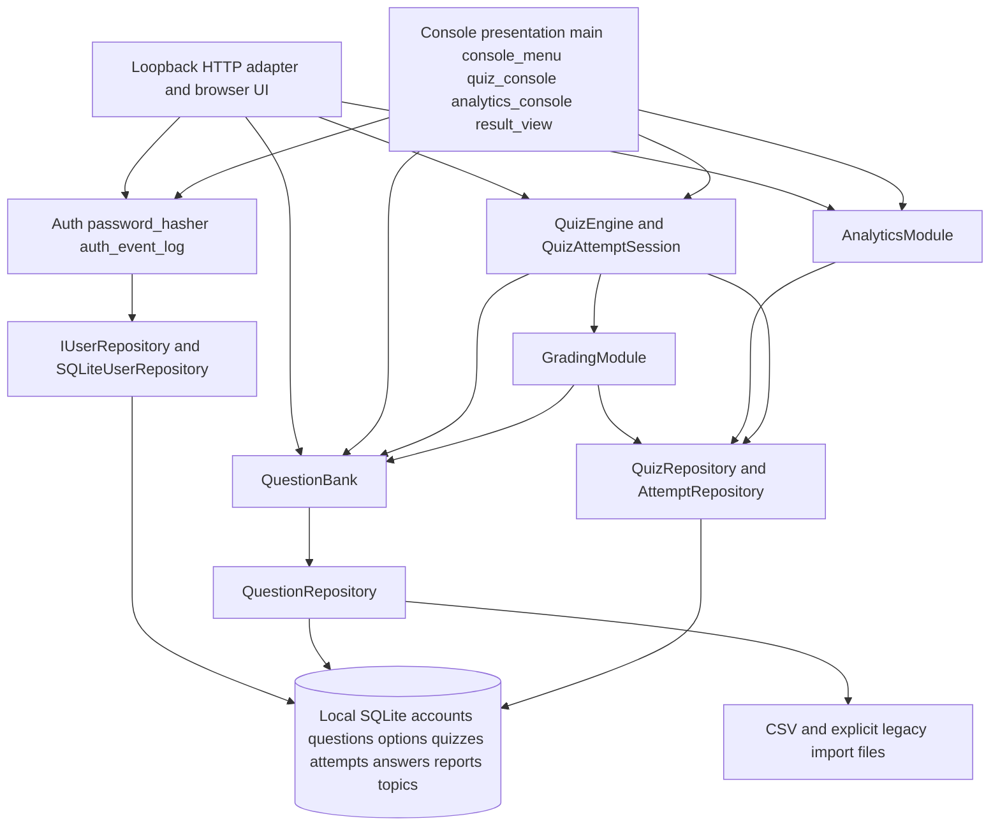
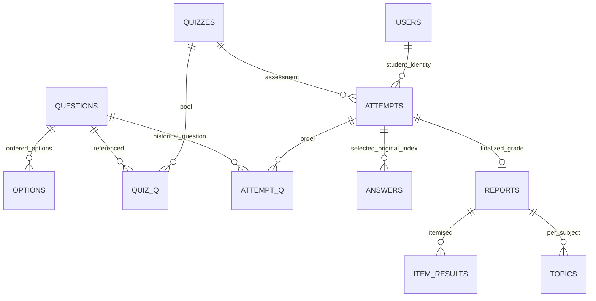
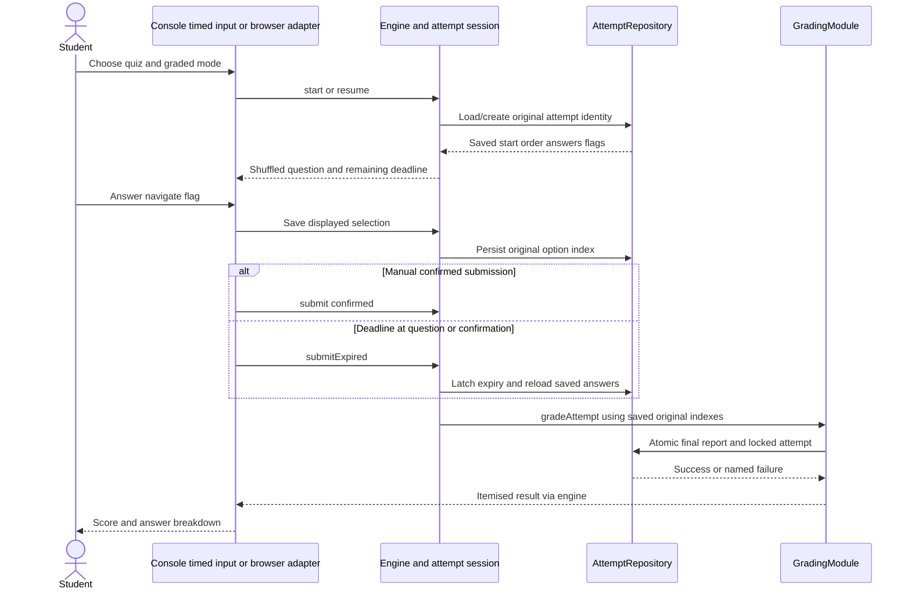
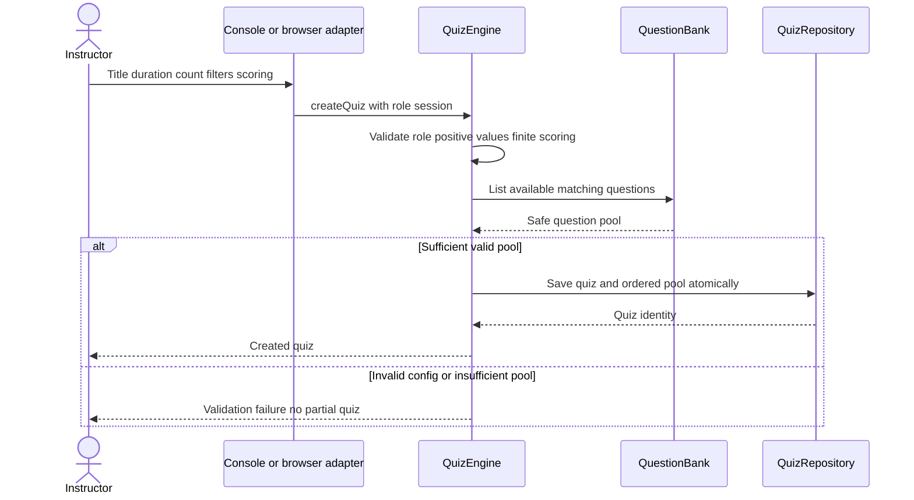

# QuizSphere Software Architecture and Design

Version 1.4 review candidate · 21 November 2026 · Team 12

This document updates the submitted SAD v1.1 to describe QuizSphere's actual C++ console architecture. It supports BL-36 and gives maintainers the interfaces, storage rules, security decisions and evidence needed to extend the application. Aryan remains the BL-36 owner; the repository owner integrates the handoff here for teammate review.

The implemented baseline is main `da6d70a6861b33169a24300bf7ae773af54f2813`, including merged PRs #82 and #83. This BL-36 document integrates the editable handoff supplied for Aryan and linked from issue #36. It is a documentation review candidate until its PR is approved and merged. The optional local browser adapter is implemented alongside the console and is recorded in SRS 1.0.3; repository-owner authorisation does not imply lecturer approval. Historical test/coverage evidence remains pinned to the source revision that was actually measured.

## 1 Document control and scope

The retained `Team12_SE_QuizSphere.pdf` contains SRS v1.0.1, SAD v1.1 and the Test Plan. This editable revision supersedes its architecture prose for review, while preserving the original PDF as the historical submission. Pair the final approved SAD with the reviewed SRS/RTM in BL-30 and the completed Test Plan addenda. Do not silently replace historical evidence.

The functional identifiers remain FR-001 through FR-022. Itemised results are FR-017, rankings FR-018, difficulty index FR-019, topic analytics FR-020 and transcripts FR-021. UC-01 through UC-09, SEC-001 through SEC-006 and the seven original business rules remain stable. Earlier notes proposing FR-023 through FR-026 and SEC-007 are proposals rather than the adopted requirement numbering.

Runtime scope is a single-machine application using a local SQLite database. The console supports Student, Instructor and Administrator workflows. Internet access is not required at runtime. CMake may fetch GoogleTest during setup if it is not already installed; an offline runtime does not imply an offline first build. Public Internet hosting, distributed multi-machine assessment, mobile applications, proctoring, payments and external LMS integration are outside the submitted baseline.

## 2 Architectural decisions

QuizSphere uses four logical layers within each native executable. Console and loopback HTTP are separate launch options over the shared core and local database. Presentation collects input and renders results. Business modules enforce authentication, question and assessment rules. Repository interfaces isolate storage. SQLite and controlled CSV/legacy files form the data store. Modules return named results rather than throwing across their public contracts.

Editable source: [diagrams/architecture.mmd](diagrams/architecture.mmd).

This modular monolith fits the four-member team and the local deployment scope. It avoids a distributed service boundary while allowing tests to construct modules with fake or real repositories. The implemented browser adapter calls these same interfaces rather than duplicating grading or persistence logic.

| Decision | Rationale | Consequence |
| --- | --- | --- |
| C++17 core and CMake | Match the team's technology allocation and support native builds | Compiler, SQLite and OpenSSL development libraries are needed |
| SQLite through repositories | Centralise transactions and persistent identity | Domain modules do not issue SQL directly |
| Interface classes and factories | Separate contracts from storage and test implementations | Maintainers must read headers before changing shared contracts |
| One shared local database per running instance | Keep questions, quizzes, attempts and reports consistent | Use disposable copies for tests and separate team development databases |
| GoogleTest and GitHub Actions | Make regressions reproducible during review | Green CI validates executed tests, not every requirement or coverage target |

## 3 Components and responsibilities

| Component | Actual implementation | Responsibility |
| --- | --- | --- |
| Console presentation | `main.cpp`, `console_menu.cpp`, `quiz_console.cpp`, `analytics_console.cpp`, `result_view.cpp`, `timed_console_input.cpp` | Route role menus, confirm destructive actions, display questions/results and read input until the deadline |
| Browser presentation | `web_application.cpp`, `web_server.cpp`, `web_main.cpp`, `web/app.js`, HTML/CSS | Serve loopback-only Student/Instructor workflows using the same core; enforce cookie/CSRF/origin controls |
| Authentication | `auth.cpp`, `password_hasher.cpp`, `auth_event_log.cpp` | Register, log in, make role-bearing sessions, enforce account policy and record safe failure events |
| Account repository | `sqlite_user_repository.cpp`, `user_repository.hpp` | Prepared SQL for accounts, enablement, roles and lockout state |
| Question Bank | `question_bank.cpp`, `question_types.hpp` | CRUD, validation, tags, availability and CSV orchestration |
| Question repository | `question_repository_file.cpp`, SQLite implementation in `data_access_layer.cpp` | Persist ordered options and question data; provide controlled legacy/file operations |
| Quiz Engine and attempt session | `quiz_engine.cpp`, `quiz_attempt.cpp` | Pool questions, retain scoring, shuffle/display-map options, navigate, save graded answers and enforce deadlines |
| Grading | `grading_module.cpp` | Validate submitted answers, score each item, produce item/topic totals and persist final reports |
| Analytics | `analytics_module.cpp` | Graded-only rankings, per-question difficulty, Student/class topic summaries and CSV transcripts |
| Shared data access | `data_access_layer.hpp`, `data_access_layer.cpp` | Quiz and attempt repositories, transactions, report lookup, duplicate prevention and immutability |

The Admin account-management backend and complete account console are integrated in main. The browser covers Student/Instructor auth, questions, quiz creation, attempts, results and rankings. Account management, class-topic reports, question CSV and transcript export are console/core workflows. Dedicated Admin item-analysis presentation remains absent; the difficulty core API is implemented.

## 4 Data model and storage

Editable source: [diagrams/data-model.mmd](diagrams/data-model.mmd).

Accounts store numeric identity, case-insensitive unique usernames, encoded password hashes, roles, enablement, failed-login counts and lock expiry. Questions retain subject, difficulty, text, availability and ordered options; MCQ is the supported question type. Quizzes retain creator, title, UTC creation time, positive duration, scoring and the ordered pool of question IDs.

An `Attempt` retains its ID, quiz/student identity, mode, UTC start, question order, original-index answers, flags, submission state and automatic-submission state. `GradeReport` retains the score, maximum score, itemised results, topic totals and timeout indicator. The shared declarations are in `common_types.hpp`, `question_types.hpp` and `quiz_types.hpp`.

Option indexes in persistent answers always refer to the original question options. `QuizAttemptSession` translates between displayed shuffled options and those indexes. Blank answers use `kBlankAnswer = -1`. Practice state is in memory and never contributes a persisted graded report or ranking. UTC strings use the ISO 8601 form `YYYY-MM-DDTHH:MM:SSZ`.

Multi-table writes are transactional. Saving an open attempt replaces its complete answer set so clearing an answer survives restart. Attempt ownership, quiz, mode and start identity cannot be rewritten. SQLite checks prevent simultaneous open graded duplicates; a finalized graded result blocks a retake, including direct DAL callers. Ambiguous legacy rows are rejected instead of arbitrarily selecting one.

Submitted attempts, answers and reports are protected against update/deletion. Questions referenced by saved quizzes or historical attempts cannot have content changed or be deleted; availability may change. Disabled questions are excluded from new pools and remain resolvable for old results. Exact report lookup by attempt ID prevents a newer retained practice report from contaminating rankings.

## 5 Assessment flows and timer design

Editable source: [diagrams/graded-attempt.mmd](diagrams/graded-attempt.mmd).

Creation requires an Instructor/Admin session, a valid scoring scheme, positive question count and positive minutes. Only available questions matching optional subject/difficulty filters enter the pool. Insufficient pools and invalid configurations save no partial quiz.

Starting graded mode either creates one open attempt or resumes its saved ID, question/option order, answers and flags. Restart reconstructs the deadline from the original UTC start plus configured minutes. While the process is active, a monotonic clock bound prevents wall-clock rollback from extending that running deadline. This is not a claim of tamper-proof time across operating-system clock changes between restarts.

The console waits for input only until the remaining deadline, including at the submit-confirmation prompt. On expiry it locks the last committed answers and calls the same Grading Module used for manual submission. An unfinished command without Enter does not become a saved answer. With the app closed or the attempt left, an expired saved attempt is finalised when next opened; no background service is claimed.

Manual and timeout submission races finalise once. If storage fails, no partial report is accepted; the expired attempt remains locked and can retry after recovery/resume. Practice remains untimed, repeatable and in memory, with immediate feedback.

The implemented BR-5 rule floors each question's awarded marks at zero before aggregation. A correct answer receives its configured marks, a blank receives zero, and a penalised wrong answer cannot contribute a negative item score. This differs from applying only a floor to the final total. Preserve this rule until the team explicitly reviews a requirement change.

Editable source: [diagrams/create-quiz.mmd](diagrams/create-quiz.mmd).

## 6 Interfaces and extension rules

| Contract | Representative operations | Boundary |
| --- | --- | --- |
| Auth | `registerUser`, `loginUser`, `makeSession`, `bootstrapAdmin`, Admin account operations | Reject public Admin registration; verify stored Admin authority for mutations |
| QuestionBank | `addQuestion`, `updateQuestion`, `deleteQuestion`, `setAvailability`, CSV methods | Protected reads expose keys only to Instructor/Admin; `PublicQuestion` omits the key |
| QuizEngine | `createQuiz`, `startAttempt`, `saveAnswer`, `remainingTime`, `submitAttempt` | Require proper role/ownership; enforce pool, identity, deadline and retake rules |
| QuizAttemptSession | `question`, `select`, `jump`, `flag`, `feedback`, `submit`, `submitExpired` | Translate display indexes and retain navigation state |
| GradingModule | `gradeAttempt`, `getReport` | Validate answers, preserve the first final result and propagate storage failures |
| AnalyticsModule | `leaderboard`, `topicLeaderboard`, `allTimeLeaderboard`, `difficultyIndex` | Use graded data and exact attempt/report identity |
| AttemptRepository | Save/find attempts and reports; `findReportForAttempt` | Own atomic writes and persistent integrity |

New code should depend on these contracts, use additive overloads where compatibility matters, and include direct module tests plus real-SQLite integration tests. Shared `Attempt`, `Answer`, scoring and option-index conventions must change through reviewed PRs. Do not fork grading logic into a UI or access the database directly from presentation code.

The integrated #75/#77 extension adds optional Analytics arguments to the console, `topicAnalytics`, `transcriptCsv` and a controlled file-repository dependency. Its merged signature must retain both the timer reader and analytics pointer: `runQuizAttempts(..., timed_read = {}, analytics = nullptr)`. Both timer and analytics arguments are retained in the integrated signature.

## 7 Security and error handling

Passwords use salted PBKDF2-HMAC-SHA256 through OpenSSL, with 600,000 iterations for production creation, a unique 16-byte salt and a 32-byte key. Verification uses the encoded parameters and constant-time key comparison. Plain SHA-256 wording in the old SAD is superseded. Passwords and hashes are not logged or displayed.

Public registration permits Student/Instructor roles. The first Admin is bootstrapped only when none exists. Stored-data checks protect Admin mutations, including stale/forged sessions, disabled/deleted actors and self-lockout prevention. Student callers must be rejected by protected module functions, not merely hidden menu entries. Core Session values are in-process objects; browser requests authenticate through separately generated opaque session tokens that map to core sessions.

| Threat | Implemented control or required boundary |
| --- | --- |
| Spoofing | Password verification, role-bearing sessions and account-status checks |
| Tampering | Prepared SQL, transactional writes, immutable submitted results and protected question references |
| Repudiation | Timestamped failed-login and import-row event logs; Git/PR history for development changes |
| Information disclosure | No plaintext/hash logging; `PublicQuestion` omits graded answer keys; Student result views use own identity |
| Denial of service | Bounded input/request/file sizes, lockout and deadline ticks during slow HTTP requests; Internet-scale denial-of-service resistance is not claimed |
| Elevation of privilege | Backend role checks, no public Admin registration and revalidation for Admin actions |

Named errors distinguish validation, authorization, missing entities, expiry, duplicate submission and I/O failures. Storage failure must propagate as a storage error rather than appear as an absent attempt. Some repository contracts return `bool` plus output/found values; the business adapter maps those results without silently treating a failed read as a missing record.

The local browser adapter binds to 127.0.0.1. OpenSSL RAND_bytes creates session tokens; cookies use HttpOnly and SameSite=Strict. POST requests require CSRF tokens, Host/Origin checks restrict requests, and header/body sizes and connection time are bounded. Browser text is escaped before HTML insertion. This is a local demonstration adapter, without public deployment/TLS or independent penetration-test claims.

HTTP readiness waits continue deadline ticks so incomplete headers or bodies do not pause automatic submission. Starting practice cannot replace an unfinished graded attempt (409). Sessions reconcile submitted-attempt state against SQLite, so completion in another browser session clears stale active pointers and stale writes are rejected. Timed confirmation retains embedded control bytes for rejection. Question Bank rejects/drains malformed or oversized lines and re-prompts; EOF remains distinct. Windows non-UTF-8 console code pages remain a documented compatibility limit.

## 8 Build testing and deployment

Build with CMake and a C++17 compiler, SQLite3 and OpenSSL. GoogleTest supplies unit/integration tests. GitHub Actions runs build/test checks and Docker validation with cppcheck; the Docker base image is pinned by digest. That digest does not individually pin every package installed in the image. Use the repository README for platform-specific dependency installation.

The source at PR #82 head 8c7b92b passed 212/212 CTest entries in each GitHub Linux and Docker job (run 44460870712). These are CTest entries, not a count of distinct GoogleTest cases. The retained Part 3 inventory records 290 distinct GoogleTest cases at cce8549; two later input-recovery tests were added. Native follow-up execution passed 206 of 211 entries; five HTTP scenarios could not connect due to Windows socket permission error 10013 in that session. These environment failures are retained in REVIEW_FOLLOWUP.md rather than relabelled passes. Merged main da6d70a passed both CI jobs in run 44489269211 after #83. #83 gives the cross-session auto-submit fixture more setup time and observes SQLite expiry before polling HTTP, preserving the regression assertions. This is not a claim that Aryan independently reran the corrected test on Windows.

The Part 3 coverage measurement is pinned to source cce8549061143fab649eab618051becc6ffc06e7: 3874/4323 production lines (89.61%) and 5740/10914 GCC-reported branches (52.59%). Scope includes compiled production src/, excluding tests/dependencies/headers and Windows-only preprocessor paths. Later input changes are not represented as freshly remeasured coverage. No 90% branch result is claimed.

PERF-01 passed five measured 20-question load/start trials on the recorded local machine (maximum 14.989645 ms against <2000 ms). This excludes fixture creation/login/process startup and is not a multi-user load benchmark. USE-01's original three-step console target is Not Accepted: the documented path has four decisions excluding credentials. Original-plan status remains 70 Pass, two Partial, one Not Accepted out of 73 IDs. Partial items are complete alternative flat-file DAL parity and dedicated Admin item-analysis presentation. Formal human/lecturer UAT approval remains pending. See current Part 3 reports in the repository.

## 9 Deviations, acceptance exceptions and release work

SAD_DEVIATIONS.md records implementation changes and outstanding acceptance exceptions. Timer, input validation, Admin console, rankings, topics, transcripts, exact graded-report selection and the optional browser adapter are integrated through the reviewed PR #82 merge. The current SRS and RTM retain original requirement IDs.

BL-33/34 evidence and this SAD must agree with PERF-01's measured local Pass and USE-01's Not Accepted outcome. An issue closure does not waive the original usability target. BL-36 remains this document review/merge task. Aryan uploaded CLI and UI clips on #37 on 20 November. The CLI clip is about 34 seconds and the UI clip about 2 minutes 56 seconds; the repository owner explicitly accepted these recordings on 21 November without an additional analytics/export recording. This is an owner-approved deviation from the original full-flow video criterion, not evidence those steps appear in the clips or that the lecturer approved a waiver. See demos/SPRINT2_DEMO.md. BL-31 remains open until final deliverables are integrated, final main CI passes and the actual v1.0 tag points to that final commit. Formal UAT and reported coverage limits remain visible.

Before closing BL-36, Aryan should review this editable SAD and Mermaid diagrams against current headers, open a PR, obtain teammate review and merge the document update. If a combined PDF is required, regenerate it from approved sources and verify its layout; this ZIP contains editable Markdown/diagrams, not a falsely labelled regenerated final PDF.

## 10 References and revision record

| Reference | Role |
| --- | --- |
| `Team12_SE_QuizSphere.pdf`, physical pages 10–17 | Historical SAD v1.1 |
| `include/` and `src/` at the pinned main SHA | Actual interfaces and implementations |
| `docs/TEST_PLAN_QUIZ_RESULTS.md` | Timer, locking and coverage evidence |
| PR #78 and its approving Windows review | Implemented timer integration and independent review |
| PRs #74, #75, #77 and #76 | Integrated protection, topic, transcript and test additions |
| PRs #68, #71 and #72 | Original PRs superseded by merged integration #82 |
| `EVIDENCE_MANIFEST.json` | Exact issue/PR snapshot and source identity |
| Issue #79 | Implemented optional local browser scope, closed through #82 |

Version 1.4 is prepared as an editable review draft for Team 12's BL-36 handoff. It changes document descriptions to match evidence without declaring unmerged work complete or asserting external approval. The original PDF is retained as historical evidence.
